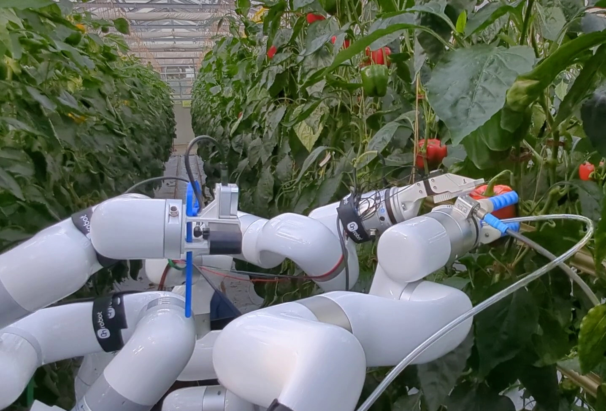
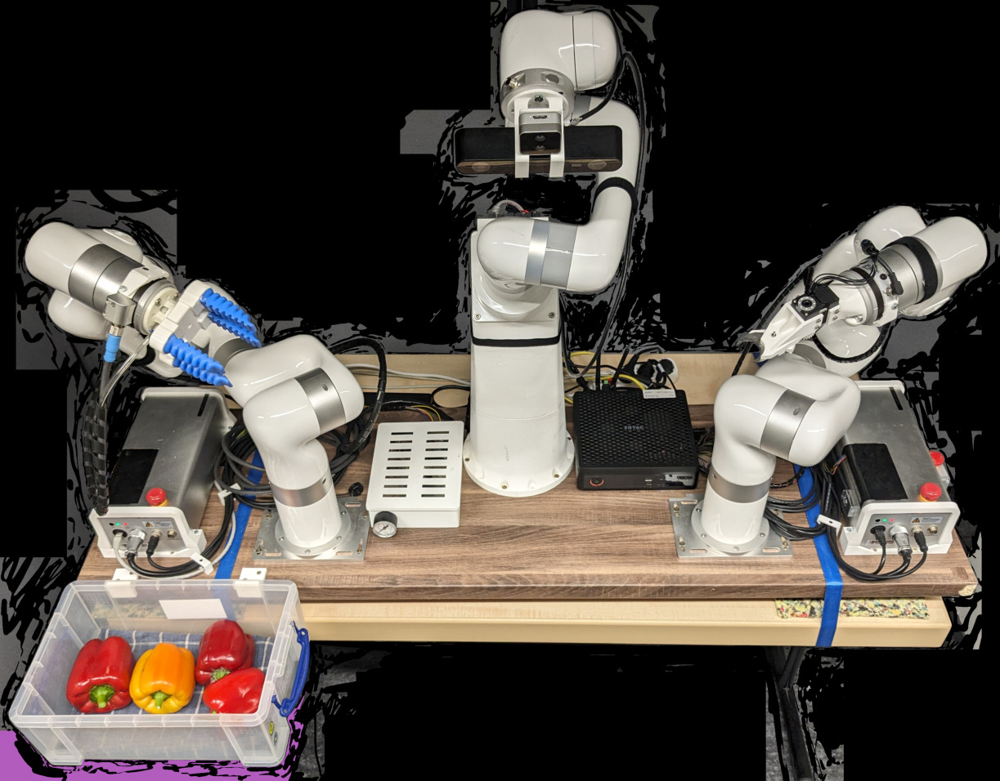
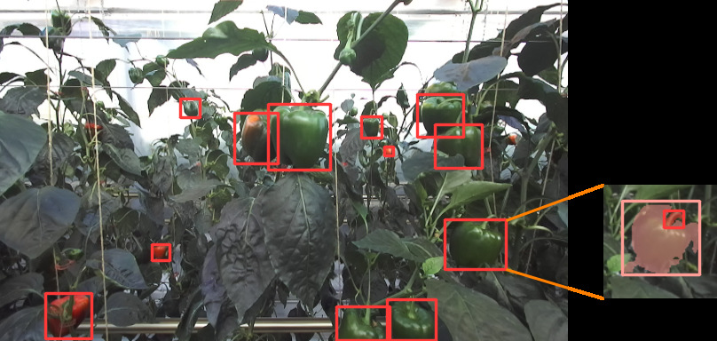
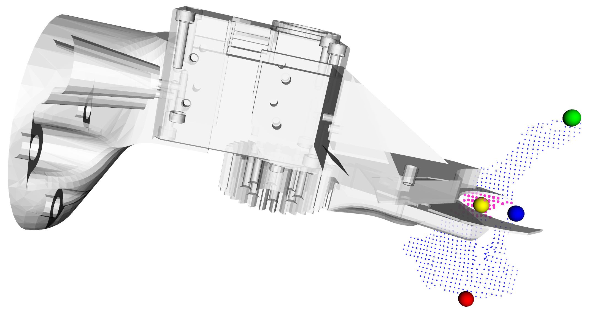

# HortiBot



HortiBot is an adaptive three-arm system for robotic horticulture. It uses two
arms for manipulation and a third arm as an articulated perception head. The
system combines pepper, peduncle, and stem perception; online world-model
updates; active perception; collision-aware trajectory generation; and
force-aware dual-arm manipulation for selective sweet-pepper harvesting.

This repository is the project landing page for **HortiBot: An Adaptive
Multi-Arm System for Robotic Horticulture of Sweet Peppers**, published at the
2024 IEEE/RSJ International Conference on Intelligent Robots and Systems.

## System



The right xArm7 carries the gripper, the left xArm7 carries the cutter, and the
central Lite6 moves the stereo perception head. The complete system is mounted
on a platform designed to fit the PATHoBot mobile base.

## Perception and Manipulation



HortiBot detects peppers in the full image, expands each fruit bounding box,
and applies a dedicated pepper/peduncle segmentation model to the crop. The
associated detections are mapped into 3D and updated during online fruit
following.



The cutting pose is estimated from the segmented peduncle point cloud and
updated online as the plant moves during manipulation.

## Evaluation

The paper reports peduncle mask mAP@50 of 0.741 and peduncle F1 of 0.781. The
combined pepper and peduncle detector required 100 ms on the HortiBot system.

In six laboratory trials, HortiBot harvested 20 of 24 peppers successfully.
All 24 fruits were grasped, 21 were cut, and 20 of the 21 cut fruits were placed
successfully.

## Software and Models

| Component | Repository | Purpose |
|---|---|---|
| Cropped peduncle detection | [pepper-peduncle-detection](https://github.com/HumanoidsBonn/pepper-peduncle-detection) | Pepper-centered peduncle instance segmentation, dataset, and checkpoint |
| Active perception planner | [active_perception_planner](https://github.com/HumanoidsBonn/active_perception_planner) | Viewpoint planning and online observation for harvesting |
| HortiBot robot model | [horti_model](https://github.com/HumanoidsBonn/horti_model) | ROS robot description and model |

The components are published separately because they have distinct runtime and
dependency requirements. Follow the setup instructions in each repository.

## Publication

- [IEEE paper](https://doi.org/10.1109/IROS58592.2024.10802082)
- [arXiv preprint](https://arxiv.org/abs/2403.15306)
- [Project video](https://www.ais.uni-bonn.de/videos/IROS_2024_Lenz/)

```bibtex
@inproceedings{lenz2024hortibot,
  author={Lenz, Christian and Menon, Rohit and Schreiber, Michael and Jacob, Melvin Paul and Behnke, Sven and Bennewitz, Maren},
  title={{HortiBot}: An Adaptive Multi-Arm System for Robotic Horticulture of Sweet Peppers},
  booktitle={2024 IEEE/RSJ International Conference on Intelligent Robots and Systems (IROS)},
  year={2024},
  pages={31--38},
  doi={10.1109/IROS58592.2024.10802082}
}
```

## Acknowledgments

This work was partially funded by the Deutsche Forschungsgemeinschaft (DFG,
German Research Foundation) under Germany's Excellence Strategy, EXC-2070 –
390732324 – PhenoRob.
